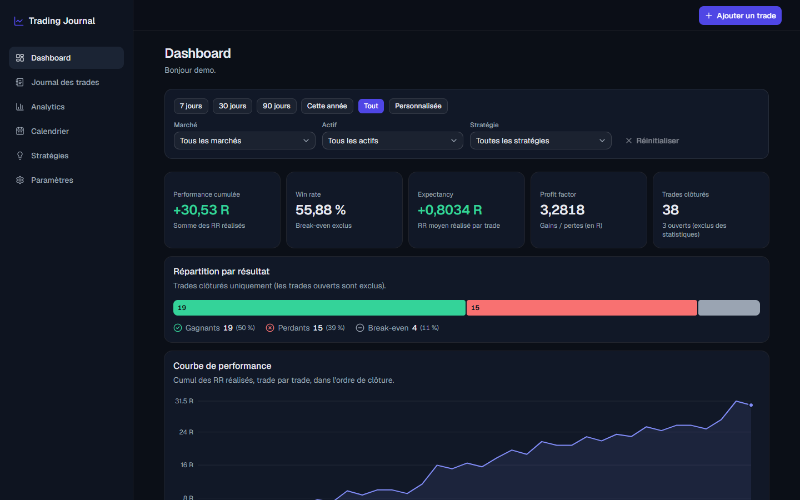
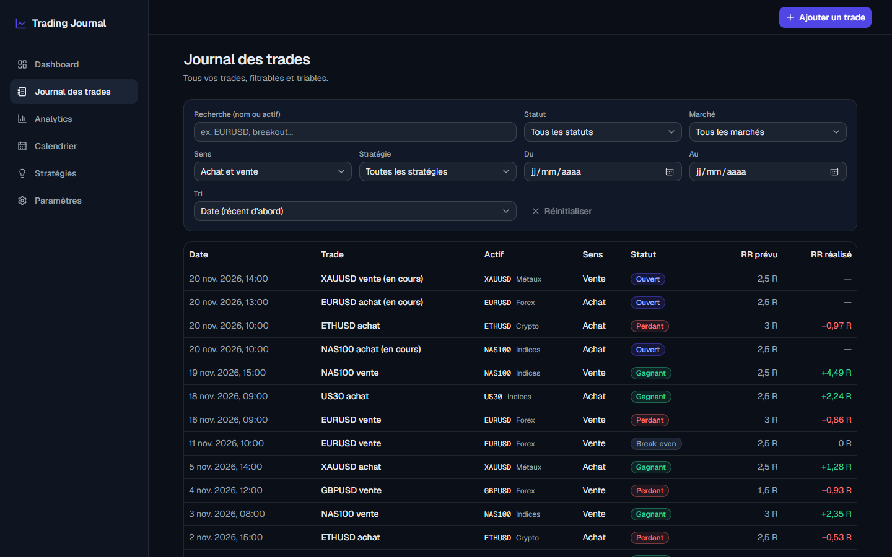
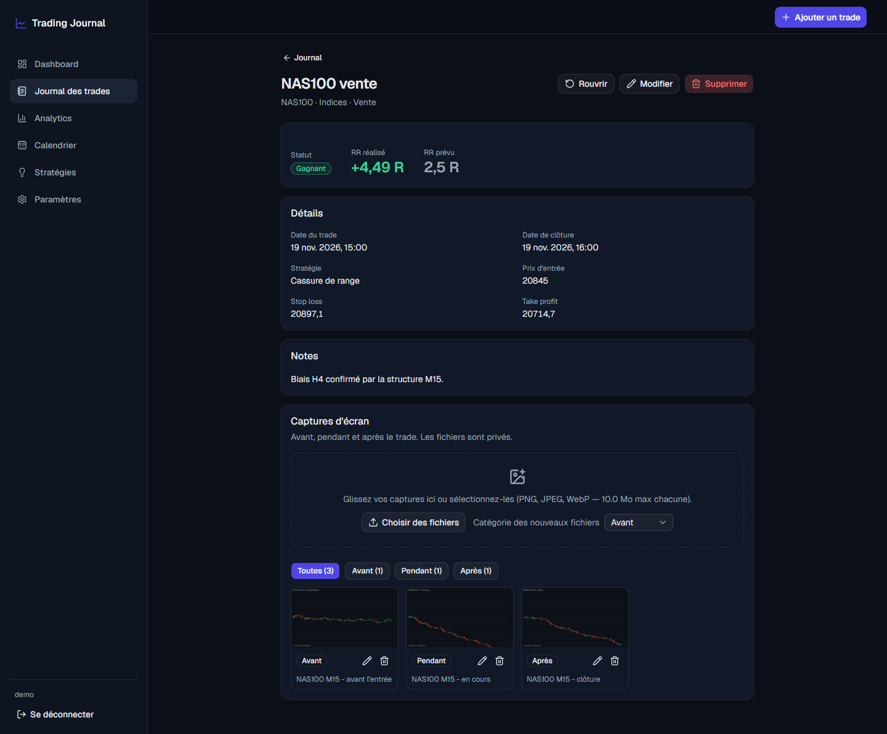
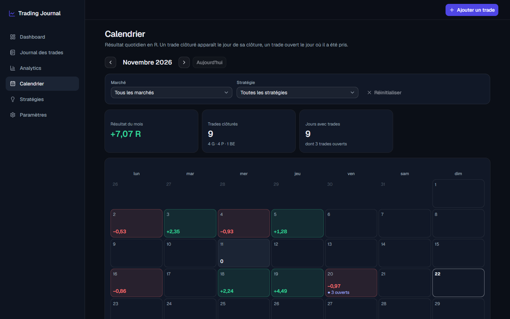
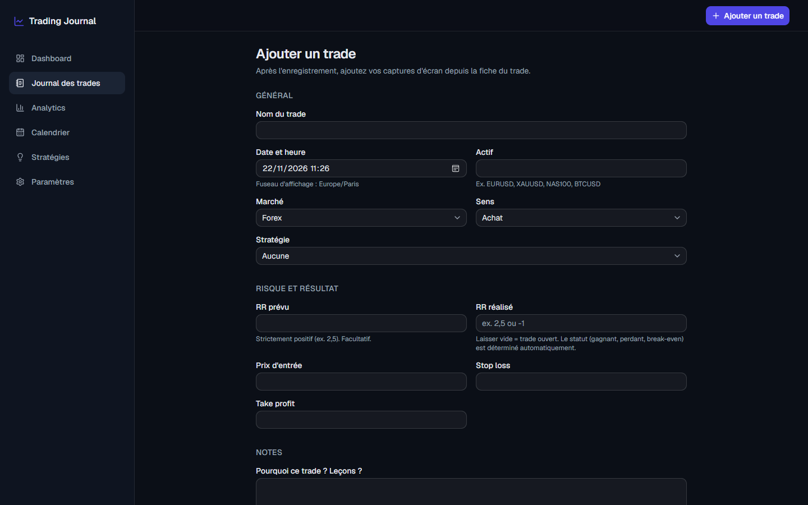
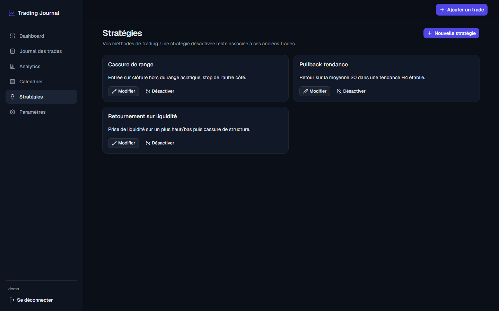
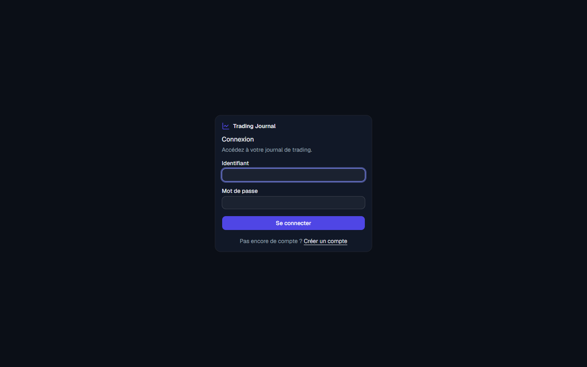
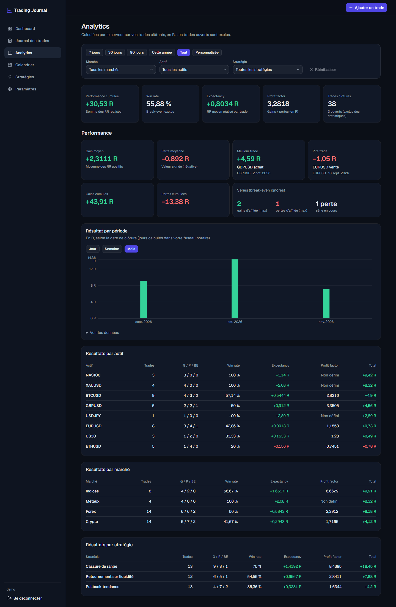
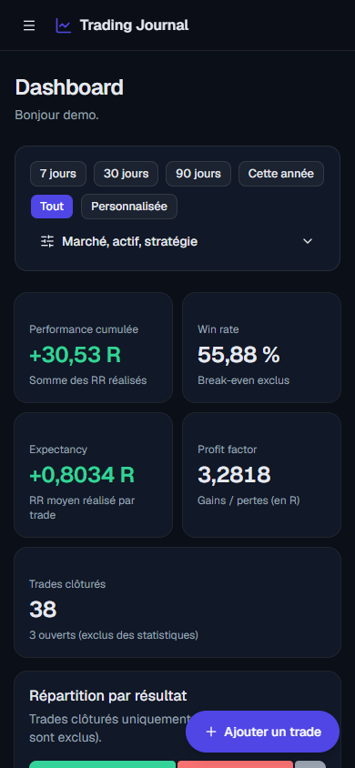

# Trading Journal

Journal de trading personnel (saisie manuelle). Conception complète : [Trading_projet.md](Trading_projet.md).

**État :** Phase 7 — MVP fonctionnellement complet : authentification, journal des trades, captures d'écran, stratégies, dashboard, analytics, calendrier, paramètres. Restent la phase 8 (validation, sécurité, sauvegardes, déploiement).

## Aperçu

> Captures prises sur l'application réelle avec un compte de démonstration rempli de **données fictives** (41 trades, septembre à novembre 2026). Les graphiques joints au trade sont des images générées pour l'exemple.



| Journal des trades | Fiche d'un trade avec ses captures |
|---|---|
|  |  |
| **Calendrier** | **Ajouter un trade** |
|  |  |
| **Stratégies** | **Connexion** |
|  |  |

<details>
<summary>Page Analytics complète et affichage mobile</summary>





</details>

## Calendrier

Vue mensuelle (semaine du lundi). Un trade **clôturé** apparaît le jour de sa **clôture**, avec son résultat en R ; un trade **ouvert** apparaît le jour où il a été **pris**, sans résultat. Les jours sont ceux de votre fuseau horaire (Paramètres). Navigation au clavier : flèches (jour/semaine), Début/Fin (semaine), PageHaut/PageBas (mois), Entrée (sélection).

## Statistiques

Calculées par le serveur, en R, sur les trades **clôturés** uniquement (les trades ouverts sont exclus). Les filtres de période portent sur la **date de clôture**. Un indicateur dont les données manquent est affiché « Non défini » (jamais 0 ni infini) : par exemple le profit factor sans aucune perte, ou le win rate sans trade gagnant ni perdant. Formules : voir `Trading_projet.md` §4.3 ; documentation de l'API : `/api/v1/docs/` (connexion requise).

## Captures d'écran

- Formats : PNG, JPEG, WebP (le format est déterminé par le **contenu** du fichier ; SVG et GIF sont refusés). Taille et nombre de fichiers configurables (`.env.example`).
- Les images sont ré-encodées à l'envoi : les métadonnées EXIF (GPS, appareil…) sont supprimées.
- Les fichiers sont privés : en développement ils sont dans `storage/` (non versionné, non servi par le web) ; en production, utilisez un bucket S3 **privé** (`STORAGE_BACKEND=s3`).
- Sauvegarde : la base **et** le stockage des captures doivent être sauvegardés ensemble (procédure détaillée en phase 8).

## Prérequis

- Git
- Docker Desktop (Compose v2) **démarré**
- (Optionnel) Node 22 pour travailler sur le frontend hors Docker

## Démarrage

```bash
cp .env.example .env      # puis remplacer les valeurs "change-me"
docker compose up -d --build
```

| Service | URL |
|---|---|
| Frontend | http://localhost:3000 |
| API (santé) | http://localhost:8000/api/v1/health/ |
| Docs API (connexion requise) | http://localhost:8000/api/v1/docs/ |

PostgreSQL n'est pas publié sur l'hôte : il n'est joignable que depuis le réseau Docker.

Le navigateur n'appelle que `http://localhost:3000` : les requêtes `/api/*` sont relayées par Next vers Django (même origine, donc cookies de session et CSRF sans CORS).

## Créer votre compte

Il n'y a pas d'inscription publique. Créez le compte personnel (le mot de passe est demandé de façon interactive) :

```bash
docker compose exec backend python manage.py createsuperuser
```

Puis connectez-vous sur http://localhost:3000.

## Vérifications

```bash
docker compose ps
docker compose exec backend python manage.py check
docker compose exec backend pytest
docker compose exec frontend npm test
curl http://localhost:3000/api/v1/health/
```

Résultat attendu de la dernière commande : `{"status":"ok","database":"ok"}`.

Hors Docker, dans `frontend/` : `npm run typecheck`, `npm run lint`, `npm test`, `npm run build`.

## Dépannage

- **Page blanche / « Impossible de joindre le serveur » après une mise à jour des dépendances** : `docker compose up -d --build -V frontend` (le `-V` recrée le volume `node_modules`).
- **Le code modifié n'est pas pris en compte** : le polling de fichiers est activé via `WATCHPACK_POLLING` dans `docker-compose.yml` (nécessaire avec Docker Desktop sous Windows).

## Arrêt

```bash
docker compose down        # conserve les données (volume pgdata)
```

Ne pas utiliser `down -v` sauf pour effacer volontairement la base.

## Structure

```
backend/    Django + DRF (config/, core/, tests/, requirements/)
frontend/   Next.js (App Router, TypeScript strict, Tailwind)
storage/    Captures en développement (non versionné)
```

Les autres éléments (apps métier, sauvegardes, déploiement) arrivent dans les phases suivantes.

## Version Windows (exécutable)

Une version autonome pour Windows (installation et configuration de PostgreSQL au premier lancement, création de compte) est décrite dans [docs/desktop.md](docs/desktop.md).
